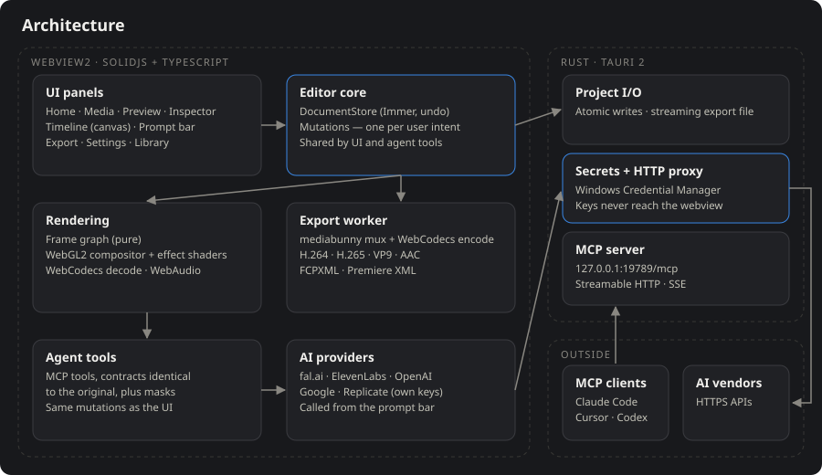

# Alcor Pro

An AI-native video editor for Windows 11. Edit on a real timeline, generate video, images and audio with your own
API keys, and let Claude Code, Cursor or Codex edit alongside you over MCP.


## Status

Alcor Pro started as a Windows port of the macOS editor [Palmier Pro](https://github.com/palmier-io/palmier-pro)
(GPLv3 source). The chart estimates how much of each area of the original is implemented.


| Area | Coverage | Notes |
|---|---:|---|
| Data model & undo | 100% | Same `.palmier` project format as the Mac app |
| Timeline editing | 95% | Move, trim, ripple, roll, slip, razor, snapping (incl. beats), keyframes, markers, nested timelines |
| Agent tools (MCP) | 95% | 50 of 52 tools; `search_media` waits on visual search, `send_feedback` has no backend |
| On-canvas handles | 90% | Move, resize, rotate, crop, eyedropper |
| Preview & compositor | 85% | WebGL2, 16 blend modes, 22 effect shaders, text rendering; no Lottie or HDR |
| Export | 85% | H.264, H.265, VP9 with AAC/Opus, FCPXML, Premiere XML; no ProRes or HDR |
| Projects & home | 85% | Autosave, Save As, project grid |
| AI generation | 85% | Bring your own keys: fal.ai, ElevenLabs, OpenAI, Google, Replicate |
| Multicam & sync | 85% | Groups, angle and mic switching, audio-waveform sync |
| Beats, silence, denoise | 85% | Beat This!, Silero VAD and DeepFilterNet3 via ONNX, downloaded on first use |
| Inspector | 80% | Video, Adjust, Audio, Text, Multicam tabs |
| Media panel | 80% | Folders, import, drag to timeline |
| Captions & transcription | 80% | ElevenLabs Scribe or OpenAI Whisper; no offline model |
| Settings | 75% | API keys, models, appearance, timeline colours, storage |
| Visual search | 0% | Not started |
| Onboarding & samples | 0% | Not started |

## Architecture



- Tauri 2 with a thin Rust backend: project file I/O, a streaming export writer, the MCP server, and an HTTP proxy
  that injects API keys from Windows Credential Manager. Keys never reach the web view.
- SolidJS and TypeScript for everything else. All editing goes through one document store with Immer-based undo,
  so UI edits and agent edits share the same code and the same history.
- Media is decoded with WebCodecs ([mediabunny](https://mediabunny.dev)), composited in WebGL2 and encoded in a
  worker. There is no ffmpeg dependency.

## Connect an agent

While Alcor Pro is open it serves MCP at `http://127.0.0.1:19789/mcp`.

```bash
claude mcp add --transport http alcor-pro http://127.0.0.1:19789/mcp
```

```bash
codex mcp add alcor-pro --url http://127.0.0.1:19789/mcp
```

Cursor and Claude Desktop instructions are in Settings.

## Build

Requirements: Windows 11, Rust (MSVC toolchain), Node 22+, pnpm, WebView2 (preinstalled on Windows 11).
Run these from `alcor-win`.

```bash
pnpm install
```

```bash
pnpm tauri dev
```

```bash
pnpm tauri build
```

```bash
pnpm test
```

Regenerate the charts after updating the numbers in `docs/progress.mjs`:

```bash
node docs/progress.mjs
```

## Licence

GPLv3, the same as the original source. Alcor Pro is derived from the published GPLv3 source of
[Palmier Pro](https://github.com/palmier-io/palmier-pro), Copyright (C) 2026 Palmier, Inc.
Alcor Pro is an independent project and is not affiliated with or endorsed by Palmier, Inc.
See [LICENSE](alcor-win/LICENSE).
