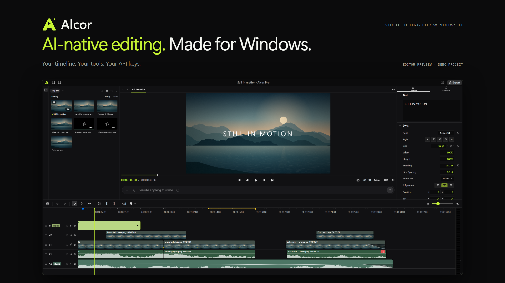
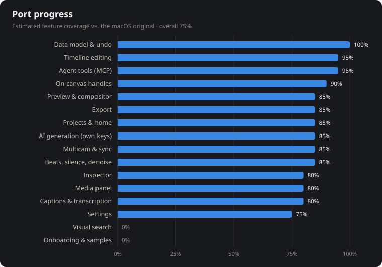

# Alcor Pro

<picture>
  <source media="(prefers-color-scheme: dark)" srcset="alcor-win/docs/brand/alcor-logo-light.svg" />
  
</picture>

An AI-native video editor for Windows 11. Edit on a real timeline, generate video, images and audio with your own
API keys, and let Claude Code, Cursor or Codex edit alongside you over MCP.



[Logo & brand kit](alcor-win/docs/brand/README.md) · [Download brand assets](alcor-win/docs/brand/alcor-brand-kit.zip)

## Status

Alcor Pro started as a Windows port of the macOS editor [Palmier Pro](https://github.com/palmier-io/palmier-pro)
(GPLv3 source). The chart estimates how much of each area of the original is implemented.



| Area | Coverage | Notes |
|---|---:|---|
| Data model & undo | 100% | Same `.palmier` project format as the Mac app |
| Timeline editing | 98% | Move, trim, ripple, roll, slip, razor, snapping (incl. beats), keyframes, markers, nested timelines, swap media |
| Agent tools (MCP) | 98% | 51 of 52 original tools plus mask, transition and speed-ramp tools; `send_feedback` has no backend |
| On-canvas handles | 95% | Move, resize, rotate, crop, eyedropper, masks, motion paths, guides, slip two-up view |
| Inspector | 92% | Video, Adjust (with histograms), Audio, Text, Multicam, AI Edit tabs |
| Media panel | 92% | Folders, import, visual search, mattes, extract audio, save clip or range as media |
| Projects & home | 92% | Autosave, project thumbnails, onboarding; sample projects still need redistributable media |
| AI generation | 90% | Bring your own keys: fal.ai, ElevenLabs, OpenAI, Google, Replicate; one prompt bar with automatic routing |
| Preview & compositor | 88% | WebGL2, 16 blend modes, 22 effect shaders, transitions, adjustment layers; no Lottie or HDR |
| Export | 88% | H.264, H.265, VP9, AAC/Opus, audio-only, FCPXML, Premiere XML; no ProRes or HDR |
| Visual search | 85% | SigLIP on this PC (207 MB, downloaded on request); one result per file rather than per shot |
| Multicam & sync | 85% | Groups, angle and mic switching, audio-waveform sync; no camera timecode reading |
| Beats, silence, denoise | 85% | Beat This!, Silero VAD and DeepFilterNet3 via ONNX, downloaded on first use |
| Settings | 85% | API keys, models, prompt routing, notifications, appearance, storage |
| Captions & transcription | 82% | ElevenLabs Scribe or OpenAI Whisper, speaker renaming; no offline model |
| Onboarding & samples | 60% | Welcome flow ported; no sample projects or in-editor tutorial |

### Beyond the original

| Feature | Notes |
|---|---|
| Masks | Rectangle, ellipse and pen masks with feather, expansion, modes and keyframes, edited on the canvas |
| Transitions | 14 GPU transitions with audio crossfades |
| Adjustment layers | Effects applied to everything below, limited by masks |
| Keyframe easing | Ease in/out, custom bezier curves, curve editor, F9 easy ease |
| Speed ramps | Six presets, smooth time remapping, frame blending on export |
| Prompt bar routing | One bar for every kind of generation; Gemini Decision 1, Mercury Decide, Jev or offline rules decide what to make |
| Bring your own keys | No account needed; keys stay in Windows Credential Manager |

## Architecture


- Tauri 2 with a thin Rust backend: project file I/O, a streaming export writer, the MCP server, and an HTTP proxy
  that injects API keys from Windows Credential Manager. Keys never reach the web view.
- SolidJS and TypeScript for everything else. All editing goes through one document store with Immer-based undo,
  so UI edits and agent edits share the same code and the same history.
- Media is decoded with WebCodecs ([mediabunny](https://mediabunny.dev)), composited in WebGL2 and encoded in a
  worker. There is no ffmpeg dependency.

## Connect an agent

While Alcor Pro is open it serves MCP at `http://127.0.0.1:19789/mcp`.

```bash
claude mcp add --transport http alcor-pro http://127.0.0.1:19789/mcp
```

```bash
codex mcp add alcor-pro --url http://127.0.0.1:19789/mcp
```

Cursor and Claude Desktop instructions are in Settings.

## Build

Requirements: Windows 11, Rust (MSVC toolchain), Node 22+, pnpm, WebView2 (preinstalled on Windows 11).
Run these from `alcor-win`.

```bash
pnpm install
```

```bash
pnpm tauri dev
```

```bash
pnpm tauri build
```

```bash
pnpm test
```

### App identity and icons

The product and window title are **Alcor Pro**; the npm package, Rust package and Windows executable are
`alcor-pro`. The application ID remains `io.alcor.pro` so existing settings and projects stay connected.

Native icons and browser favicons are generated from `docs/brand/alcor-app-icon.png`:

```bash
pnpm run brand:icons
pnpm run brand:check
```

After changing native icons, rebuild with `pnpm tauri build` to embed them in the executable and installer.
An already-running build keeps its previous executable icon until rebuilt and restarted.

Regenerate the charts after updating the numbers in `docs/progress.mjs`:

```bash
node docs/progress.mjs
```

## Licence

GPLv3, the same as the original source. Alcor Pro is derived from the published GPLv3 source of
[Palmier Pro](https://github.com/palmier-io/palmier-pro), Copyright (C) 2026 Palmier, Inc.
Alcor Pro is an independent project and is not affiliated with or endorsed by Palmier, Inc.
See [LICENSE](alcor-win/LICENSE).
